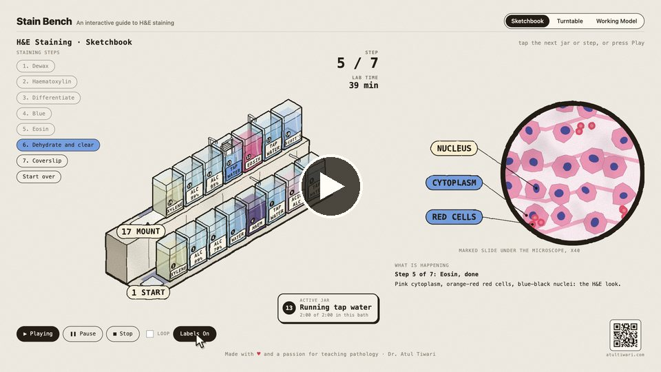
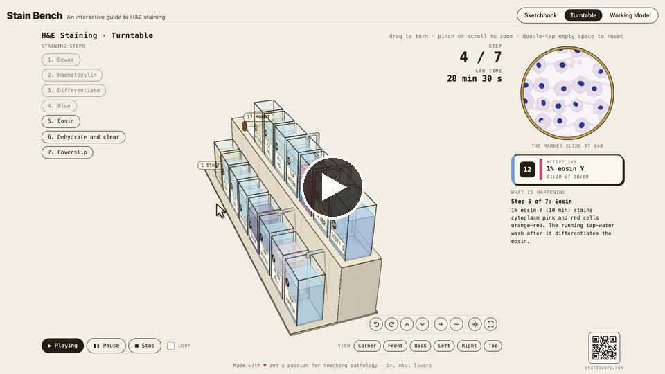
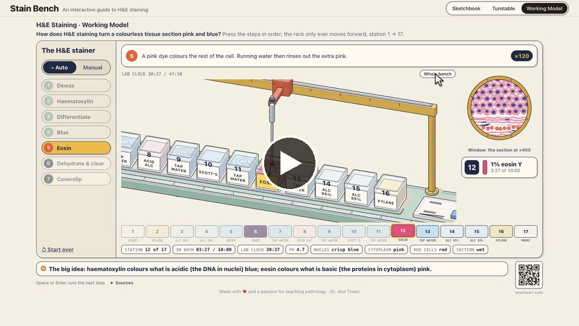
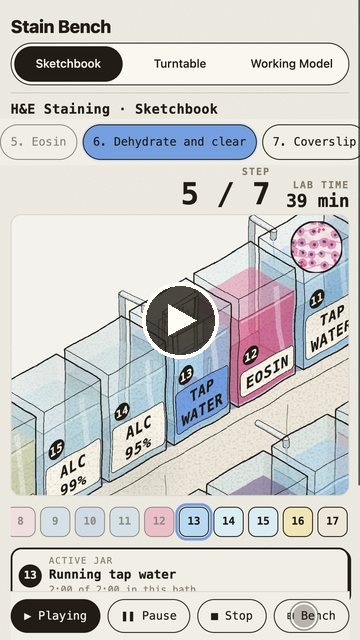
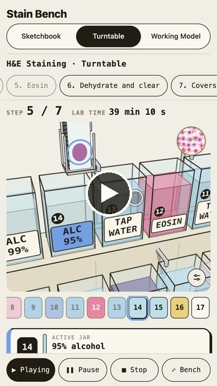
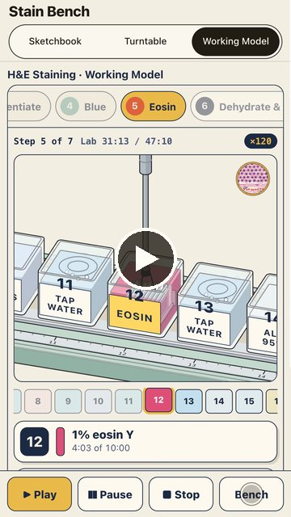

# Stain Bench

**An interactive guide to H&E staining.** Interactive teaching figures of routine haematoxylin and eosin (H&E) staining of paraffin sections, for medical students, pathology residents and laboratory trainees.

**Live site:** https://atultiwari.github.io/stain-bench/

A rack of slides moves forward through 17 numbered stations, from dewaxing to coverslipping, while a magnified view of the section shows what each reagent does: nuclei turning blue-black, cytoplasm pink, red cells orange-red.

## Three versions of the same protocol

Switch between them with the bar at the top of every page.

| Version | What it is |
|---|---|
| **Sketchbook** | A hand-drawn 2D staining bench. Tap the jars or the steps; the microscope view changes with each reagent. |
| **Turntable** | The same bench in 3D. Drag to turn it, pinch to zoom, view it from any side or full screen. |
| **Working Model** | A linear slide stainer where every number on screen (lab clock, time in each bath, pH, stain uptake) comes from one small model of the protocol. |

All three share the same stations, jar names and lab times (47 min 10 s in total), and work on phones: on small screens the view follows the rack up close, with the steps and stations as swipeable strips.

## Videos

Click a picture to play the video in your browser.

### Laptop (16:9)

**Sketchbook**

<a href="https://atultiwari.github.io/stain-bench/media/videos/stain-bench-sketchbook-16x9.mp4"></a>

**Turntable**

<a href="https://atultiwari.github.io/stain-bench/media/videos/stain-bench-turntable-16x9.mp4"></a>

**Working Model**

<a href="https://atultiwari.github.io/stain-bench/media/videos/stain-bench-working-model-16x9.mp4"></a>

### Phone: YouTube Shorts and Instagram Reels (9:16)

<table><tr>
<td align="center"><b>Sketchbook</b><br><a href="https://atultiwari.github.io/stain-bench/media/videos/stain-bench-sketchbook-9x16.mp4"></a></td>
<td align="center"><b>Turntable</b><br><a href="https://atultiwari.github.io/stain-bench/media/videos/stain-bench-turntable-9x16.mp4"></a></td>
<td align="center"><b>Working Model</b><br><a href="https://atultiwari.github.io/stain-bench/media/videos/stain-bench-working-model-9x16.mp4"></a></td>
</tr></table>

The MP4 files are in [`media/videos/`](media/videos/).

## Protocol and reference

The staining sequence, reagents and times follow:

> **Bancroft's Theory and Practice of Histological Techniques, 8th edition**
> Edited by S. Kim Suvarna, Christopher Layton and John D. Bancroft. Elsevier, 2019.
> Chapter 10, *The hematoxylins and eosin* (regressive alum haematoxylin and eosin method for paraffin sections), and chapter 11, *Automation in the histology department* (reagent layout of a linear stainer).

The full station list, with the source of each time, is in [docs/protocol.md](docs/protocol.md). Times the book does not give (xylene and alcohol baths) are common laboratory practice and marked as such. Always follow your own laboratory's validated protocol.

## Run it locally

The site is plain HTML and JavaScript with no build step, except for the Working Model page.

```bash
npx serve .
```

Then open the address it prints. To rebuild the Working Model page after editing `working-model/src/`:

```bash
node working-model/src/build.mjs
```

Its model has a test: `node --test working-model/src/model.test.mjs`.

## Layout

```
sketchbook/       Hand-drawn 2D version (engine.js + index.html)
turntable/        3D version (Three.js, loaded from a CDN)
working-model/    Model-driven version: index.html is built from src/
shared/           The version switcher and the QR code
docs/             Protocol and phone-layout notes
media/            Demo videos (laptop and phone) and their poster images
```

## Credits

Made with ♥ and a passion for teaching pathology by **Dr. Atul Tiwari** · [atultiwari.com](https://atultiwari.com/)

Inspired by the interactive figures shared by [@Aprilzz423](https://x.com/Aprilzz423), [@elvar_official](https://x.com/elvar_official) and [@wheresryan22](https://x.com/wheresryan22).

## Licence

MIT, see [LICENSE](LICENSE). Parts of the drawing engines are adapted from MIT-licensed work; their notices are in [THIRD_PARTY_LICENSES.md](THIRD_PARTY_LICENSES.md).
